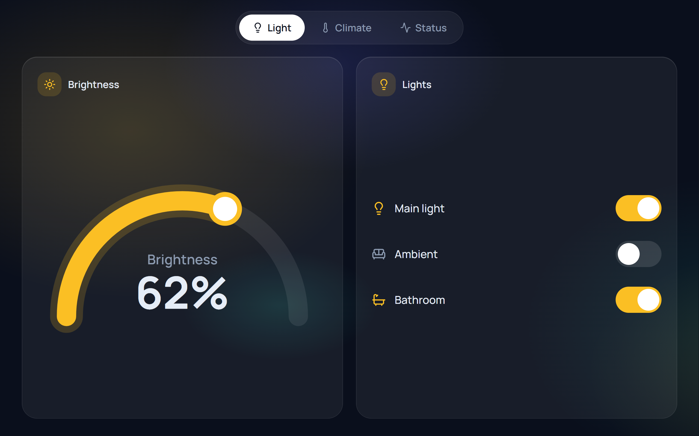

# Touch Panel Demo

A touch-screen control panel for a smart home, built with React and TypeScript. It is a portfolio demo sized for a 10.1" 1280×800 display and also adapts to phones: swipe between four pages, arc and linear sliders, toggles, segmented controls, a dropdown and a chart, all running on mock data.

**Live demo:** https://touch-panel-demo.pages.dev



## What it shows

- **Four pages:** Light, Climate, Energy, Status.
- **Swipe navigation.** Tapping a menu button animates the same way, so it feels like a swipe rather than an instant switch. Three background layers move at different speeds (parallax).
- **Gestures that do not fight each other.** Dragging a slider never starts a page swipe, and vertical scroll stays available on small screens.
- **Touch controls:** custom arc slider (SVG + pointer events), linear slider with ticks (boiler), colour slider (lights), finger-sized toggles, segmented buttons (AC mode, light scenes) and a dropdown (chart period).
- **Chart** of electricity consumption with a Day / Week / Month selector and touch tooltip (Recharts).
- **Live mock data.** Indoor temperature drifts towards the target, and the Status page shows what each module is doing (for example "2 of 3 lights on", "Heating to 55°C"), not just online or offline.
- **Responsive.** Two-column layout on a 1280×800 panel, stacked cards and compact menu on phones.
- **Data layer.** Components only talk to `src/data/useDevices.ts`, so the mock source can later be replaced with Home Assistant (REST/WebSocket) without touching the UI.
- **Light visuals.** Semi-transparent panels instead of live blur, transform/opacity animations only, chart animation off, parallax can be switched off with one constant.

## Tech stack

React, TypeScript, Vite, Tailwind CSS 4, Framer Motion, use-gesture, Recharts, lucide-react.

## Run locally

```bash
pnpm install
pnpm dev
```

Open the address shown in the terminal. To try it on a phone on the same Wi-Fi: `pnpm dev --host`.

Build for production: `pnpm build` (output in `dist`).

## Project structure

```
src/
  App.tsx                    page container, swipe, parallax, navigation
  components/                Card, ArcSlider, LinearSlider, Toggle, Segmented, Select, EnergyChart
  pages/                     Light, Climate, Energy, Status
  data/useDevices.ts         mock data layer (swap for Home Assistant later)
  data/energy.ts             mock consumption data
```

## Status and roadmap

Not done yet:
- Dashboard overview page, Settings and profile menu
- Loading, error and offline states
- Home Assistant integration (REST + WebSocket)
- Kiosk mode, autostart and testing on real Raspberry Pi hardware

## Notes

The design is original and uses mock data only. No accounts, keys or personal data are involved.